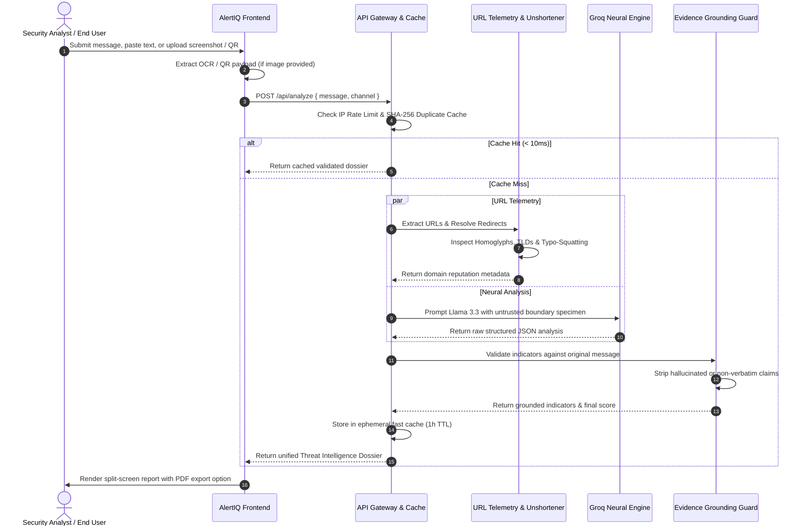

<div align="center">

  

  # AlertIQ
  ### Enterprise Scam Detection, Phishing Intelligence & Threat Analysis Platform

  [](https://nextjs.org/)
  [](https://react.dev/)
  [](https://www.typescriptlang.org/)
  [](https://tailwindcss.com/)
  [](https://groq.com/)
  [](LICENSE)

  <p align="center">
    <strong>Verify deceptive text messages, phishing emails, shortlinks, and QR codes before you click.</strong><br/>
    Built with privacy-first volatile memory processing, verbatim evidence verification, and real-time neural reasoning.
  </p>

</div>

---

## Table of Contents

- [Overview](#overview)
- [Key Features](#key-features)
- [System Architecture](#system-architecture)
- [Data Flow Pipeline](#data-flow-pipeline)
- [Technology Stack](#technology-stack)
- [Repository Structure](#repository-structure)
- [Getting Started](#getting-started)
  - [Prerequisites](#prerequisites)
  - [Local Installation](#local-installation)
  - [Environment Variables](#environment-variables)
- [Production Deployment](#production-deployment)
  - [Deploying to Vercel](#deploying-to-vercel)
  - [Vercel CLI Method](#vercel-cli-method)
- [Testing & Quality Assurance](#testing--quality-assurance)
- [Security & Privacy Standards](#security--privacy-standards)
- [License & Authors](#license--authors)

---

## Overview

Social engineering attacks have evolved far beyond generic spam. Threat actors deploy sophisticated brand lookalikes, disposable shortcodes, urgency extortion, homoglyph character substitutions, and QR code redirects ("quishing") across SMS, WhatsApp, Telegram, and corporate email.

**AlertIQ** provides an autonomous, real-time decision-support system. It dissects untrusted messages, traces obscured redirection chains, verifies verbatim evidence character-for-character, and delivers a structured executive threat dossier without storing any user data.

---

## Key Features

- **Split-Screen Security Console**: Fixed, pinned left-side scanner paired with an independently scrollable forensic report view.
- **Multimodal Screenshot OCR**: Direct image upload and clipboard paste (`Ctrl + V`) to extract text from chat screenshots, banking SMS alerts, and email snips.
- **QR Code ("Quishing") Decoder**: Integrated client-side canvas QR decoder that unmasks encoded URLs embedded within invoices and notices.
- **HTTP Redirect Chain & URL Unshortening**: Follows HTTP 301/302 redirects across URL shorteners (`bit.ly`, `tinyurl`, `t.co`, `cutt.ly`, `is.gd`) to reveal the final destination domain.
- **Homoglyph & Punycode Spoofing Detection**: Identifies non-Latin lookalike characters (Cyrillic, Greek) crafted to mimic trusted domain names.
- **Levenshtein Brand Typo-Squatting Engine**: Computes string distance against high-profile financial, tech, and postal brands to identify deceptive domains (e.g., `wellsfarg0.com`, `paypa1.com`).
- **Multilingual & Hinglish Recognition**: Evaluates regional extortion tactics, fake utility power disconnection threats (*"Bijli cut ho jayegi"*), and transliterated fraud patterns.
- **Sub-10ms In-Memory Duplicate Cache**: SHA-256 normalized caching returns instant verified verdicts for mass-distributed scam campaigns.
- **Zero Hallucination Verbatim Grounding**: Every flagged threat indicator is programmatically validated against the raw specimen string. Unmatched indicators are discarded.
- **Print-Protected PDF Dossier Export**: Clean A4 print stylesheet with `page-break-inside: avoid` protection ensuring reports never clip or break awkwardly.

---

## System Architecture

```
+=============================================================================+
|                          CLIENT APPLICATION LAYER                           |
|  - Next.js 16 App Router (React 19 Server & Client Components)              |
|  - Split-Screen Console: Pinned Scanner Form + Scrollable Report View       |
|  - Client-Side Tesseract.js OCR & jsQR Canvas Scanner (Clipboard Ctrl+V)    |
|  - Print-Protected A4 PDF Dossier Generation Module                         |
+======================================+======================================+
                                       |
                     HTTP POST JSON (Payload < 4000 chars)
                                       |
+======================================v======================================+
|                         INGESTION & GATEWAY LAYER                           |
|  - IP Sliding Window Rate Limiter (30 req / min / IP)                       |
|  - Zod Request Schema Validation & Sanitization                             |
|  - In-Memory SHA-256 Duplicate Scam Cache (Sub-10ms Cache Hit Return)       |
+======================================+======================================+
                                       |
                   +-------------------+-------------------+
                   |                                       |
+==================v==================+ +==================v==================+
|     URL TELEMETRY & RECON ENGINE     | |       NEURAL REASONING ENGINE       |
|  - Safe RFC 3986 URL Extraction      | |  - Groq Cloud API Gateway           |
|  - HTTP Redirect Unshortener Chain   | |  - Llama 3.3 70B / GPT-OSS Models   |
|  - Homoglyph & Punycode Detector     | |  - Multilingual & Hinglish Context  |
|  - Levenshtein Brand Typo-Squatting  | |  - System Directive: Specimen Only  |
|  - Google Safe Browsing v4 (Optional)| |  - Strict Structured JSON Schema   |
+==================+==================+ +==================+==================+
                   |                                       |
                   +-------------------+-------------------+
                                       |
+======================================v======================================+
|                     EVIDENCE VERIFICATION & AUDIT CORE                      |
|  - Verbatim Grounding Engine: Exact substring validation against specimen   |
|  - Synthetic Threat Aggregator: Combines URL intelligence with LLM verdict   |
|  - Score Calibration: 0 - 100 Risk Index and Classification Matrix          |
|  - Volatile Memory Scrub: Immediate garbage collection (Zero Log Retention)  |
+======================================+======================================+
                                       |
                           Structured JSON Dossier
                                       |
+======================================v======================================+
|                          EXECUTIVE REPORT CONSUMER                          |
|  - High / Medium / Low Risk Verdict Banner & Threat Severity Gauge          |
|  - Plain-English Executive Summary (Nishkarsh)                              |
|  - Specimen Highlighter with In-Context Threat Callouts                     |
|  - Verified Proof & Threat Indicators Table (Saboot)                        |
|  - Domain & Hyperlink Inspection Status                                     |
|  - Recommended Action Steps Checklist (Upay)                                |
+=============================================================================+
```

---

## Data Flow Pipeline



---

## Technology Stack

| Layer | Technology | Version | Purpose |
|---|---|---|---|
| **Core Framework** | Next.js (App Router, Turbopack) | 16.4.2 | Server & client rendering, optimized API routes |
| **User Interface** | React | 19.3.0 | Component hierarchy, state management |
| **Language** | TypeScript | 5.x | Strict type safety across endpoints and schemas |
| **Styling** | Tailwind CSS | v4 | Modern utility design, custom high-contrast theme |
| **Typography** | Google Fonts | Inter, Plus Jakarta Sans, JetBrains Mono | Geometric display headings, clean body copy, telemetry |
| **Icons** | Lucide React | Latest | Clean, lightweight SVG iconography |
| **Neural Inference**| Groq SDK | 1.6.0 | Sub-second Llama 3.3 70B structured threat reasoning |
| **Image OCR** | Tesseract.js | 5.1.x | Client-side Optical Character Recognition |
| **QR Decoding** | jsQR | 1.4.x | Canvas-based QR code payload extraction |
| **Validation** | Zod | 4.6.x | Runtime request body schema validation |
| **Testing** | Vitest | 5.0.x | Unit and integration testing |

---

## Repository Structure

```text
AlertIQ/
├── public/
│   ├── logo.svg                     # High-contrast SVG brand emblem
│   └── favicon.ico                  # Browser tab icon
├── src/
│   ├── app/
│   │   ├── api/
│   │   │   ├── analyze/
│   │   │   │   └── route.ts         # Threat analysis controller with fast cache
│   │   │   ├── evaluate/
│   │   │   │   └── route.ts         # Benchmark evaluation endpoint
│   │   │   └── health/
│   │   │       └── route.ts         # Production health check probe
│   │   ├── scan/
│   │   │   └── page.tsx             # Split-screen threat scanner page
│   │   ├── globals.css              # Theme tokens, print styles, and utilities
│   │   ├── layout.tsx               # Root layout with fonts and metadata
│   │   └── page.tsx                 # SaaS landing page with value pillars
│   ├── components/
│   │   ├── AnalysisResults.tsx      # Structured report & print-ready PDF exporter
│   │   ├── AnalyzerForm.tsx         # Pinned scanner with OCR, QR & presets
│   │   ├── AppNavbar.tsx            # Clean scanner header
│   │   ├── Footer.tsx               # Footer with volatile memory notice
│   │   ├── LandingNavbar.tsx        # Marketing landing header
│   │   └── Logo.tsx                 # Vector logo component
│   ├── lib/
│   │   ├── evaluationDataset.ts     # Stratified benchmark corpus
│   │   ├── evaluationRunner.ts      # Statistical metrics calculator
│   │   ├── evidenceVerifier.ts      # Verbatim string grounding guard
│   │   ├── groqProvider.ts          # Groq LLM integration & prompt directives
│   │   ├── heuristicAnalyzer.ts     # Offline deterministic regex engine
│   │   ├── imageProcessor.ts        # Client-side Tesseract OCR & jsQR decoder
│   │   ├── types.ts                 # TypeScript types and Zod schemas
│   │   └── urlSafety.ts             # URL unshortening, homoglyph & typo detector
│   └── types/
│       └── jsqr.d.ts                # TypeScript declarations for jsQR
├── .env.example                     # Environment variable template
├── .gitignore                       # Git ignore specification
├── LICENSE                          # MIT License
├── next.config.ts                   # Next.js configuration
├── package.json                     # Project manifest and dependencies
├── tsconfig.json                    # TypeScript compiler configuration
└── vitest.config.mjs                # Test runner configuration
```

---

## Getting Started

### Prerequisites

Ensure you have the following installed on your workstation:
- **Node.js**: `v20.x` or later (LTS recommended)
- **Package Manager**: `npm` (v10+), `yarn`, or `pnpm`
- **Groq API Key**: Obtain a free API key at [console.groq.com/keys](https://console.groq.com/keys)

### Local Installation

1. **Clone the Repository**:
   ```bash
   git clone https://github.com/Abhi666-max/AlertIQ.git
   cd AlertIQ
   ```

2. **Install Dependencies**:
   ```bash
   npm install --legacy-peer-deps
   ```

3. **Configure Environment Variables**:
   ```bash
   cp .env.example .env.local
   ```
   Open `.env.local` and provide your Groq API credentials:
   ```env
   GROQ_API_KEY=gsk_your_actual_groq_api_key_here
   GROQ_MODEL=llama-3.3-70b-versatile
   ```

4. **Start Development Server**:
   ```bash
   npm run dev
   ```
   Open [http://localhost:3000](http://localhost:3000) in your browser.

---

## Environment Variables

| Variable | Required | Default | Description |
|---|---|---|---|
| `GROQ_API_KEY` | **Yes** | — | Secret API key from Groq Cloud for ultra-fast Llama 3.3 inference. |
| `GROQ_MODEL` | No | `llama-3.3-70b-versatile` | Model to use. Supported: `llama-3.3-70b-versatile`, `llama-3.1-8b-instant`. |
| `GOOGLE_SAFE_BROWSING_API_KEY` | No | — | Google Cloud API key for Safe Browsing Lookup v4. Fallback is internal heuristics. |

---

## Production Deployment

AlertIQ is optimized for zero-configuration deployment on **Vercel**.

### Deploying to Vercel (Dashboard Method)

1. Push your repository to GitHub:
   ```bash
   git push origin master
   ```
2. Navigate to [vercel.com/new](https://vercel.com/new) and select **AlertIQ**.
3. In the **Environment Variables** panel, add:
   - `GROQ_API_KEY`: Your production Groq API key.
   - `GROQ_MODEL`: `llama-3.3-70b-versatile` (or `openai/gpt-oss-120b`).
4. Click **Deploy**. Vercel will build the project using Turbopack and provision edge endpoints automatically.

### Vercel CLI Method

```bash
# Install Vercel CLI
npm i -g vercel

# Link and deploy
vercel

# Add production secrets
vercel env add GROQ_API_KEY production

# Deploy to production
vercel --prod
```

---

## Testing & Quality Assurance

AlertIQ includes automated unit tests covering URL safety, evidence grounding, heuristic scoring, and benchmark calculations:

```bash
# Run unit test suite
npm test

# Run TypeScript compilation verification
npx tsc --noEmit

# Test production build locally
npm run build
```

---

## Security & Privacy Standards

- **Zero Server Retention**: User specimens are analyzed in ephemeral execution contexts and discarded immediately. No messages or phone numbers are ever stored in a database.
- **SSRF Immunity**: The server never follows arbitrary user-supplied URLs without domain validation. URL unshortening enforces strict timeout and header limits.
- **Adversarial Prompt Injection Hardening**: Specimens are encapsulated within strict `<<<UNTRUSTED_MESSAGE>>>` delimiters in the system prompt. The LLM is instructed to treat all inputs strictly as text specimens, not instructions.
- **Environment Protection**: Sensitive configuration files (`.env*`, `.pem`) are blocked in `.gitignore` and never committed to version control.

---

## License & Authors

This project is licensed under the **MIT License** — see the [LICENSE](LICENSE) file for complete details.

**AlertIQ** is designed, developed, and maintained by:

**Abhijeet Kangane**  
GitHub: [@Abhi666-max](https://github.com/Abhi666-max)  
*Built for digital safety, threat transparency, and zero-compromise privacy.*
